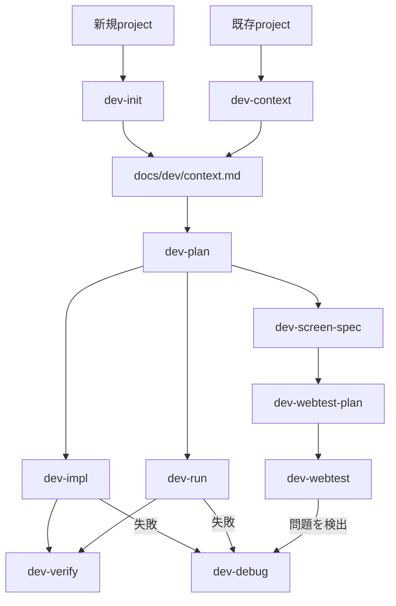

# AIスキル

スキルの管理方法と使い方をまとめます。エージェントの起動・セッション・ブラウザ接続は [AI エージェント](ai.md) を参照してください。

## skill のコンテキスト管理

skill の本体は APM（[`docs/apm.md`](apm.md)）と rulesync（[`docs/rulesync.md`](rulesync.md)）で global
（`~/.claude/skills` など）に配布したまま、**Claude に見せるかどうか**だけを設定で切り替えます。

### skill はどれだけコンテキストを使うか

- 常に入るのは、各 skill の**名前と説明文の一覧**だけです（Claude がどの skill を使うか判断するため）。
- 本文（`SKILL.md`）は、その skill を実際に使ったときだけ読み込まれます。
- 一覧には上限があり、既定はコンテキストの 1% です。超えると、使われていない skill から説明文が削られます
  （`skillListingBudgetFraction` または環境変数 `SLASH_COMMAND_TOOL_CHAR_BUDGET` で変更できる）。
- 量は `/context` の Skills の行で確認できます。`/skill-doctor` を使うと、一度も使っていない skill や plugin が分かります。

### skill を絞る方法（3 系統）

#### 1. 設定で skill ごとの見せ方を決める（`skillOverrides`）

`/skills` の画面で切り替えると `.claude/settings.local.json` に書かれます。どの設定ファイルにも書けます。

| 値                      | 効果                                                      |
| ----------------------- | --------------------------------------------------------- |
| `"on"`                  | 名前と説明を一覧に載せる（書かなかった skill もこの扱い） |
| `"name-only"`           | 名前だけ載せる。説明文の分のコンテキストが減る            |
| `"user-invocable-only"` | Claude からは見えない。`/名前` で手動でだけ使える         |
| `"off"`                 | Claude からも `/` メニューからも隠す                      |

Claude Code の plugin の skill には効きません（下の 2 で plugin ごと切り替える）。

#### 2. plugin をプロジェクトごとにオン・オフする（`enabledPlugins`）

`"<plugin>@<marketplace>": true | false` を user（`~/.claude/settings.json`）・project（`.claude/settings.json`）・
local（`.claude/settings.local.json`）のどこにでも書けます。plugin ごとに、優先度の高い場所に書いた値が勝ちます
（local > project > user）。無効にした plugin の skill が一覧から消えることはドキュメントに明記されていないため、
`/context` で確認します。

#### 3. skill 側の書き方で絞る

- `disable-model-invocation: true`（`SKILL.md` のフロントマター）: 説明ごとコンテキストから消え、`/名前` でだけ動く。
  `user-invocable: false` は `/` メニューから隠すだけで、コンテキストは減らない。
- `paths`（フロントマター）: 指定したパターンに合うファイルを触ったときだけ自動で読み込む。
- サブディレクトリの `.claude/skills/`: 起動時には読まれず、そのディレクトリのファイルを最初に読み書きしたときに読み込まれる。

APM で入れた upstream の skill はフロントマターを書き換えても更新で消えるため、3 は自作の skill（rulesync）でだけ使います。

そのほか、セッション単位で全部止めるなら `--disable-slash-commands`（skill とコマンドを全部無効）や `--bare`
（skill・plugin・MCP・CLAUDE.md の自動読み込みを止める）があります。

### 3 層に分けて管理する

| 層                         | 置き場所                                                                                | 役割                                                           |
| -------------------------- | --------------------------------------------------------------------------------------- | -------------------------------------------------------------- |
| 本体                       | `apm/apm.yml`・`config/rulesync/.rulesync/skills/` → `~/.claude/skills`                 | skill をインストールする。どのプロジェクトでも使える状態にする |
| 既定の見せ方               | `claude/settings.json`（`~/.claude/settings.json`）の `skillOverrides`                  | 普段の一覧を軽くしておく                                       |
| プロジェクトごとの切り替え | 各リポジトリの `.claude/settings.local.json`（commit しない）か `.claude/settings.json` | そのプロジェクトで使う skill を `"on"` に上げる                |

プロジェクト側に書くときは、`claude/settings.json` の `skillOverrides` を丸ごとコピーしてから、そのプロジェクトで
使う skill の値だけを変えます。

```jsonc
// 例: フロントエンドのリポジトリの .claude/settings.local.json
{
  "skillOverrides": {
    // claude/settings.json の skillOverrides をすべてコピーし、次の値だけ変える
    "html-prototype": "on",
    "html-wireframe": "on",
  },
}
```

> [!IMPORTANT]
> user とプロジェクトの両方に `skillOverrides` を書いたとき、skill ごとに合わさるのか、プロジェクト側で丸ごと
> 置き換わるのかはドキュメントで確認できていません。丸ごと置き換わる場合、プロジェクト側に変えたい skill だけを
> 書くと、書かなかった skill がすべて `"on"` に戻ります。そのため上のとおり全 skill をコピーして書きます。
> 確かめるときは、1 つのリポジトリで `/context` の Skills の行を見ます。

### 既定の設定（`claude/settings.json`）

| 値                    | skill                                                                                                                                                                                                                                                                                                                                                                                                                                |
| --------------------- | ------------------------------------------------------------------------------------------------------------------------------------------------------------------------------------------------------------------------------------------------------------------------------------------------------------------------------------------------------------------------------------------------------------------------------------ |
| `on`                  | crit（`crit` / `crit-cli`）、ponytail（`ponytail` / `ponytail-*`）、`memo`、`planning`、`pr-author-lessons-review`                                                                                                                                                                                                                                                                                                                   |
| `name-only`           | plannotator（`plannotator-review` / `-annotate` / `-last`）、effective-html（`html` / `html-*` / `design-artifact`）、`terminal-browser`、grill-me（`grill-me` / `grilling`）、`diagram-design`、`desloppify`、`pr-reviewer-comment-crit`、`pr-author-fix`、`pr-author-all-review`、`lessons-record`、`pr-reviewer-comment`、`pr-reviewer-brief`、`pr-reviewer-behavior`、`tmux`、tsumiki の `dev-impl` / `dev-verify` / `dev-debug` |
| `user-invocable-only` | 上以外（tsumiki の残りの `dev-*` / `ipa-security-*` / `kairo-implement` / `task-breakdown` / `uat-test-design`、`ctx-agent-history-search`、`find-skills`、`prompt-master`、`suggest-rules`、`lessons-harvest`、`lessons-review`）                                                                                                                                                                                                   |

- 複数の skill をまとめて配る package（crit・ponytail・plannotator・effective-html・grill-me）は、package 単位で同じ値にしています。
  `pr-reviewer-comment-crit` は `crit` / `crit-cli` の使い方を前提にし、`grill-me` は `grilling` を、tsumiki の `dev-run` は
  `dev-impl` / `dev-verify` / `dev-debug` を呼び出すため、呼ばれる側を `user-invocable-only` にすると Claude から
  使えなくなります（呼ばれる側は `name-only` 以上にする）。
- `skillOverrides` に無い skill は `"on"` として一覧に載ります。`apm/apm.yml` や rulesync に skill を足したら、ここにも追加します。

### plugin の管理

Claude Code の plugin は、skill とは別に `enabledPlugins` で管理します。

| 種類                                                   | 例                                                  | 管理の仕方                                                                                                              |
| ------------------------------------------------------ | --------------------------------------------------- | ----------------------------------------------------------------------------------------------------------------------- |
| 公式 marketplace（`claude-plugins-official`）の plugin | `frontend-design` など                              | marketplace は最初から登録済み。`enabledPlugins` に書いて有効にする                                                     |
| 他の marketplace の plugin                             | `expo-deployment@expo-plugins` など                 | `/plugin marketplace add` で marketplace を足し、`enabledPlugins` に書く                                                |
| Claude Code 本体に同梱の skill（bundled）              | `/code-review`、`/simplify`、`/loop`、`/claude-api` | 普段は残す（使うときだけ本文が読まれる）。全部外すなら `disableBundledSkills`（`CLAUDE_CODE_DISABLE_BUNDLED_SKILLS=1`） |
| claude.ai のアカウント側の skill・plugin               | Web / cloud セッションの `anthropic-skills:*` など  | dotfiles では管理できない。claude.ai の設定で外す                                                                       |

方針:

- `claude/settings.json` には今 `enabledPlugins` を書いていない（global で有効な plugin は無い）。どのプロジェクトでも使う plugin ができたら、ここで `true` にする。
- 特定のプロジェクトでだけ使う plugin（例: Expo のリポジトリの `expo-deployment`）は、global には書かず、
  そのリポジトリの `.claude/settings.json`（チームで共有する）か `.claude/settings.local.json`（自分だけ）で `true` にする。
- `enabledPlugins` は有効・無効を切り替えるだけで、plugin を入れてはくれない。plugin を使う端末ごとに
  `/plugin install <plugin>@<marketplace>`（他の marketplace なら先に `/plugin marketplace add`）で入れておく。

### 関連リンク

- [Skills（Claude Code）](https://code.claude.com/docs/en/skills)
- [Plugins の読み込み](https://code.claude.com/docs/en/plugins/loading)
- [Settings](https://code.claude.com/docs/en/settings)

## 配布とインストール

外部skillは `apm/apm.yml`、自作skillはrulesyncで管理します。このページでは次のskillの使い方を説明します。

- Plannotator / Effective HTML skills
- `crit` / `crit-cli`
- `terminal-browser`
- Tsumiki skills
- Ponytailの6 skill
- `ctx-agent-history-search`
- `grill-me`（内部で `grilling` を使用）
- `diagram-design`
- `find-skills`
- `prompt-master`
- `desloppify`
- `pr-reviewer-behavior`（自作）

### インストール

設定を反映してから APM を実行します。

```bash
mise bootstrap dotfiles apply
mise --cd "$HOME" run apm:install
```

`mise run apm:install` は user scope で skill をインストールします。Claude Code では
`~/.claude/skills/`、Codex・GitHub Copilot・Cursor では共通の `~/.agents/skills/` に配置されます。
インストール後は、エージェントを新しいセッションで起動してください。

依存先は再現性のため `apm/apm.yml` で commit SHA またはrelease tagに pin しています。更新時は upstream の内容を確認して
`ref` を変更し、もう一度 `mise bootstrap dotfiles apply` と `mise --cd "$HOME" run apm:install` を実行します。

## Plannotator / Effective HTML

### 導入構成

- Plannotator CLIはhostとdevcontainer / sbxの両方でmise toolとしてインストールします。
- `plannotator-review`、`plannotator-annotate`、`plannotator-last`とEffective HTMLの6 skillsは
  APMでuser scopeへ配布します。
- APMのskillはClaude Codeでは`/<skill-name>`、Codexでは`$<skill-name>`として呼び出せるため、
  Plannotator用のslash command fileを別途管理しません。
- Claude Codeのplan review hookはRulesyncのglobal hook、Codexのplan review hookは`~/.codex/hooks.json`で
  設定します。どちらもplan終了時にCLIを呼び、Plannotatorが未インストールのhostでは何もせず終了します。
- code、HTML、agent responseのreviewはhookでは自動起動せず、次のskillを明示的に呼び出します。

### HTML artifactを作成してreviewする

[Effective HTML](https://github.com/plannotator/effective-html)のskillは、作りたいartifactに合わせて使い分けます。

| skill              | 使いどころ                                                  |
| ------------------ | ----------------------------------------------------------- |
| `$html`            | report、explainer、presentation、landing pageなどの汎用HTML |
| `$design-artifact` | palette、typography、layoutなどのvisual directionを決める   |
| `$html-wireframe`  | 情報設計や導線を確認するlow-fidelity wireframe              |
| `$html-prototype`  | 見た目を確認するmockup、または操作できるprototype           |
| `$html-plan`       | plan、roadmap、rollout、実装手順                            |
| `$html-diagram`    | architecture、sequence、process、state、hierarchyのdiagram  |

`$html`は汎用の入り口です。作るものがwireframeやprototypeと明確な場合は、
対応するspecialist skillを直接指定します。`$design-artifact`は他のskillと組み合わせて
visual directionを調整する場合に使えます。

```text
$html-wireframe 管理画面の情報階層と2つの導線案をHTMLで作成して

$html-prototype ユーザー登録から完了までの操作可能なprototypeをHTMLで作成して

$design-artifact $html-plan この実装planをprojectのdesign languageに合わせて可視化して
```

作成したHTMLはPlannotator skillからreviewできます。Plannotatorはskill実行時に起動するため、
container起動時にPlannotatorを常駐起動する必要はありません。

```text
$plannotator-annotate path/to/artifact.html
```

CLIを直接実行する場合は次を使います。

```bash
plannotator annotate path/to/artifact.html
```

### 開発中のfrontendをreviewする

devcontainer内でfrontendのdev serverを起動します。Expo Webの例では次を実行します。

```bash
npx expo start --web --host lan
```

Viteなど、任意のhostからのaccessを明示的に許可するdev serverは次のように起動します。

```bash
npm run dev -- --host 0.0.0.0
```

dev serverが表示したloopback URLを別のterminalまたはagent sessionからPlannotatorへ渡します。
`--app`はlive annotationを必須にし、pageを開けない場合はstatic contentへ自動fallbackせずerrorを返します。

```text
$plannotator-annotate http://localhost:8081 --app
```

CLIで直接起動する場合は次のとおりです。Viteの例ではportを`5173`に変えます。

```bash
plannotator annotate 'http://localhost:8081' --app
plannotator annotate 'http://localhost:5173/admin?tab=users' --app
```

Plannotatorはdev serverを内部のrandom portでreverse proxyします。review起動時にeditor portと
このlive-app proxy portを同じport番号のままSSH reverse tunnelでmacOSへ公開し、browserで自動的に開きます。
URLとCSPのoriginがcontainer内とhost側で一致するため、live iframeも表示できます。
review中もnavigation、form操作、hot reload、WebSocketを利用できます。pen toolで要素をclickするか
textを選択してcommentを付け、**Send Annotations**でfeedbackをagentへ戻します。

tabを自動で閉じたくない場合は、Plannotator右上の**Settings**を開き、
**Auto-close Tab**を**Off**にします。この選択はbrowserに保存されるため、以後のreviewにも適用されます。
ただし、**Send Annotations**は現在のCLI sessionを完了させる操作です。tabを残しても完了画面になり、
同じannotation UIやlive appを引き続き操作することはできません。agentがfeedbackを反映した後に
`$plannotator-annotate <URL> --app`をもう一度実行し、新しいreview sessionで確認してください。
critのように1つの画面をfeedback送信後も継続利用する動作は、Plannotatorの現行session modelでは利用できません。

live modeで開けないpageをcontentとしてreviewする場合は、snapshot取得を明示します。

```bash
plannotator annotate 'http://localhost:8081' --static --no-jina
```

host側のPlannotator URLで「接続が拒否されました」と表示される場合は、tunnelの状態とlogを確認します。

```bash
ps -ef | grep '[s]sh.*127.0.0.1:19433'
cat ~/.cache/plannotator-tunnels/19433.log
```

`plannotator-browser`はreview起動ごとに必要な2本のtunnelを起動します。複数のdevcontainerが同時に
Plannotatorを使うとeditor portの`19433`が衝突するため、reviewするcontainerは1つだけにしてください。
`19433`は`devcontainer.json`の`PLANNOTATOR_PORT`です。変更する場合は、この確認commandも同じ値に読み替えます。
Plannotatorとdev serverのprocessは、review中はterminalで終了させないでください。

### code diffをreviewする

current branchの変更は次のskillでreviewします。

```text
$plannotator-review
```

GitHub PRをreviewする場合はPR URLを渡します。

```text
$plannotator-review https://github.com/owner/repository/pull/123
```

### agentの最後の返答をreviewする

```text
$plannotator-last
```

## `crit` / `crit-cli`

### 用途

`crit`はcode diff、plan、ローカルHTML、実行中のWeb applicationをbrowser UIで確認し、行や要素へcommentを付けて
エージェントへ戻すreview skillです。`crit-cli`はcommentの作成・返信、reviewの共有、GitHub PRとの同期などを
エージェントがCLIから操作するための補助skillであり、通常は直接起動しません。

### 使い方

`crit`はユーザーが明示的に起動します。Claude Codeでは`/crit`、Codexでは`$crit`を使い、必要に応じてreview対象を
指定します。

```text
/crit docs/plan.md
```

```text
$crit を使って、現在のgit diffをreviewできるようにしてください。
```

devcontainerでは`crit`を起動した後、表示されたhost側URLをbrowserで開きます。commentを送信するとエージェントが
修正し、再reviewできます。CLIの構成、PR commentのpull / push、tool比較は[`docs/crit.md`](crit.md)を参照してください。

## `terminal-browser`

### 用途

terminal pane内に実browserを表示し、エージェントが同じtabに対してsnapshot、click、入力、JavaScript評価を行うskillです。
Web applicationの動作確認、生成したHTMLの可視化、browser上でしか確認できない状態の調査に使用します。

### 使い方

browserで確認したいURLと操作内容を自然言語で伝えます。明示的に指定する場合は、Claude Codeでは
`/terminal-browser`、Codexでは`$terminal-browser`を使用します。

```text
$terminal-browser を使って http://localhost:3000 を開き、login formを操作してerrorがないか確認してください。
```

skillは必要に応じてterminalを分割し、`terminal-browser action`で開いているtabを操作します。認証情報や個人情報を
入力させる場合は、実行する操作と送信先を事前に確認してください。

## Tsumiki skills

Tsumikiは、project初期化、context生成、plan作成、TDD実装、検証、debug、Web test、security checkをつなぐ開発workflowです。
Codexでは依頼内容に応じて自動選択され、`$<skill-name>`で明示もできます。Claude Codeでは`dev-impl`・`dev-verify`・`dev-debug`は`name-only`で、Claudeから自動呼び出しできます。それ以外の表中のskillは`user-invocable-only`として、`/<skill-name>`で明示的に呼び出します（[skill のコンテキスト管理](#skill-のコンテキスト管理)）。

| skill                | 用途                                                                                         |
| -------------------- | -------------------------------------------------------------------------------------------- |
| `dev-context`        | projectの技術stack、test framework、規約、architectureを分析し、context fileを生成・更新する |
| `dev-debug`          | test失敗、build・compile error、環境問題を分類し、原因を絞って修正する                       |
| `dev-impl`           | plan内のtaskまたは直接指定した小規模変更を、TDDをguardrailとして実装する                     |
| `dev-init`           | 対話で新規projectの技術stackを決め、承認後にscaffoldとcontextを生成する                      |
| `dev-navigate`       | 目的を聞き取り、使用するTsumiki skillと実行順序を案内する                                    |
| `dev-plan`           | 要件をinterface-firstの設計とtest可能なtaskへ分解し、`docs/dev/plans/`へ保存する             |
| `dev-run`            | plan内のtask範囲を`dev-impl`、`dev-verify`、`dev-debug`のflowで連続実行する                  |
| `dev-screen-spec`    | source codeまたはplanから画面仕様を生成し、既存仕様を差分更新する                            |
| `dev-verify`         | planの完了状態とtest・build・lintの整合性を検証し、reportを出力する                          |
| `dev-webtest-plan`   | dev planや画面仕様からPlaywright用のWeb test planを生成・更新する                            |
| `dev-webtest`        | Playwrightで画面動作、visual、accessibility、responsive、formをtestする                      |
| `ipa-security-check` | IPAの公開資料に基づいてsource codeを静的検査し、出典付きで脆弱性候補を報告する               |
| `ipa-security-guide` | security診断reportを読み、優先順位付きの`dev-debug`依頼リストへ変換する                      |
| `task-breakdown`     | 開発に限らない依頼を、依存関係と完了条件を持つ実行可能なtaskへ構造分解する                   |
| `uat-test-design`    | repositoryを分析し、業務・system・非機能の受入test項目を階層化して生成する                   |

最初にどのskillを使うべきか分からない場合は、次のように`dev-navigate`へ相談します。

```text
/dev-navigate
既存Web applicationへ決済機能を追加したいです。どの順番で進めるべきですか。
```

```text
$dev-plan checkout "決済providerを追加し、失敗時に安全にretryできるようにする"
```

既存projectで一連のworkflowを始める場合は、通常`dev-context` → `dev-plan` → `dev-impl`または`dev-run` →
`dev-verify`の順で使用します。Web UIを含む場合は`dev-webtest-plan`と`dev-webtest`、security確認が必要な場合は
`ipa-security-check`と`ipa-security-guide`を組み合わせます。

### Tsumiki 入門ガイド

#### 現行の中心は Dev Skills

Tsumikiの現行workflowはDev Skillsです。従来このページで中心としていたKairo・個別TDD・DIRECT commandは、upstreamで
`tsumiki-legacy` pluginへ分離されたlegacy機能です。新しい開発ではDev Skillsを使用し、Kairoを前提とした
`kairo-requirements` → `kairo-design` → `kairo-tasks`という手順は採用しません。

Dev Skillsは、新規projectの初期化または既存projectの分析から、計画、test-first実装、検証、debug、Web testまでを
次のようにつなぎます。



どこから始めるか判断できない場合は、`dev-navigate`へ目的を伝えます。

```text
/dev-navigate
既存Web applicationへ決済機能を追加したいです。どのskillから始めるべきですか。
```

#### 基本workflow

##### 1. Contextを準備する

新規projectでは`dev-init`が技術stackを対話で決定し、承認後にscaffoldします。既存projectでは`dev-context`が技術stack、
test framework、規約、architectureを分析します。どちらも後続skillが共有する`docs/dev/context.md`を生成します。

```text
/dev-init
```

```text
/dev-context
```

##### 2. Planを作る

`dev-plan`はinterface-firstの設計とtest可能なtaskを`docs/dev/plans/<plan-name>/`へ出力します。素早く計画する
Lightweight modeと、EARS要件、user story、受け入れ条件まで作るFull-spec modeがあり、実行中に選択します。

```text
/dev-plan auth "ユーザー認証機能を実装"
```

既存のPRDを入力にすることもできます。

```text
/dev-plan auth ./docs/prd.md
```

##### 3. 実装する

taskを1件ずつ実装する場合は`dev-impl`へplan名とtask IDを渡します。Planを作るほどではない軽微な変更には、修正指示を
直接渡すquick modeを使用できます。どちらもRed → Green → Refactorをguardrailとするtest-first実装です。

```text
/dev-impl auth 001
```

```text
/dev-impl "validation messageを日本語へ変更"
```

複数taskを連続実行する場合は`dev-run`へ対象範囲を渡します。各taskについて`dev-impl`、`dev-verify`、失敗時の
`dev-debug`を組み合わせて実行します。

```text
/dev-run auth 001 005
```

##### 4. 検証・debugする

`dev-verify`はplanのtask完了状態、test、build、lint、file sizeを確認し、
`docs/dev/plans/<plan-name>/reports/`へreportを出力します。

```text
/dev-verify auth
```

失敗の原因を調べて修正する場合は`dev-debug`を使用します。errorの自動検出、error messageの直接指定、Web testで
検出した問題を扱う`webtest` modeに対応します。

```text
/dev-debug "TypeError: Cannot read properties of undefined"
```

#### Web UIをtestする

Web UIを含む変更では、画面仕様、Playwright test計画、実行を分離します。

1. `dev-screen-spec`でsource codeまたはplanから`docs/dev/screen-specs/`へ画面仕様を生成・差分更新する。
2. `dev-webtest-plan`でplanと画面仕様からPlaywright用test計画を生成・差分更新する。
3. `dev-webtest`で計画test、monkey test、visual、accessibility、responsive、formを確認する。
4. 問題が見つかった場合は`dev-debug webtest`で修正する。

```text
/dev-screen-spec from-plan auth
/dev-webtest-plan auth
/dev-webtest auth
/dev-debug webtest
```

#### その他の現行command

Dev Skills以外にも、目的別のcommandを使用できます。

| カテゴリ            | 主なcommand                                                              | 用途                                                     |
| ------------------- | ------------------------------------------------------------------------ | -------------------------------------------------------- |
| DCS                 | `dcs:feature-rubber-duck`、`dcs:impact-analysis`、`dcs:bug-analysis`など | PRD作成、影響範囲・bug・performance・edge caseなどの分析 |
| utility             | `help`、`orchestrate`、`refine-plan`、`refine-execute`                   | command案内、複雑な依頼の編成、小規模変更の計画と実行    |
| error対応           | `auto-debug`、`build-fix`、`env-fix`、`flaky-fix`、`timeout-fix`         | test、build、環境、flaky test、timeoutの修正             |
| reverse engineering | `rev-tasks`、`rev-design`、`rev-specs`、`rev-requirements`               | 既存codeからtask、設計、test仕様、要件を逆生成           |

このdotfilesではTsumiki commandをRulesync経由でも配布します。Claude Codeでは`/tsumiki-<name>`、Codexでは
`$tsumiki-<name>`として呼び出します。たとえばhelpは`/tsumiki-help`または`$tsumiki-help`です。詳細は
[`docs/rulesync.md`](rulesync.md)を参照してください。

#### Legacy commandについて

Kairo、個別TDD、DIRECTが必要な既存workflowでは、upstreamの`tsumiki-legacy` pluginを明示的に導入し、Claude Codeで
`/tsumiki-legacy:<command>`として実行します。たとえばKairoの要件定義は
`/tsumiki-legacy:kairo-requirements`です。現行の`tsumiki` pluginだけを導入した環境では利用できません。

新規作業でKairoの成果物や手順をそのままDev Skillsへ読み替えないでください。Dev Skillsではcontextを
`docs/dev/context.md`、planを`docs/dev/plans/<plan-name>/`で管理し、個別のTDD commandではなく`dev-impl`が
test-first実装を担当します。

## Ponytail skills

Ponytailは、YAGNI、standard library、native platform機能、既存dependencyの順に検討し、要件を満たす最小の実装を
選ぶcoding workflowです。短いcodeを目的化するのではなく、security、accessibility、trust boundaryのvalidation、
data lossを防ぐerror handlingは省略しません。

| skill             | 用途                                                                                |
| ----------------- | ----------------------------------------------------------------------------------- |
| `ponytail`        | 最小の正しい実装を選ぶmode。`lite`、`full`、`ultra`の3段階を切り替えられる          |
| `ponytail-review` | 現在のdiffから過剰なabstraction、不要なdependency、再実装されたstdlibなどを探す     |
| `ponytail-audit`  | repository全体を対象に、削除・単純化できる箇所を優先順位付きで報告する              |
| `ponytail-debt`   | source内の`ponytail:` commentを収集し、意図的に先送りした制約と改善条件を一覧化する |
| `ponytail-gain`   | 公開benchmarkに基づくcode量、cost、処理時間への影響をscoreboardで表示する           |
| `ponytail-help`   | mode、skill、command、無効化方法をquick referenceとして表示する                     |

### 使い方

通常modeは`full`です。Claude Codeでは`/ponytail`、Codexでは`$ponytail`を使い、必要に応じてlevelを指定します。

```text
/ponytail lite
このAPI clientへretryを追加してください。
```

```text
$ponytail ultra を使って、この変更を実現する最小のdiffを作ってください。
```

過剰実装だけをreviewするときは`ponytail-review`、repository全体を調べるときは`ponytail-audit`を使用します。これらは
correctness、security、performanceのreviewを置き換えないため、必要に応じて通常のcode reviewと併用してください。

```text
$ponytail-review を使って、現在のdiffから削除できるabstractionを探してください。
```

Ponytailを止めるときは「stop ponytail」または「normal mode」と伝えます。default levelを変える場合は
`PONYTAIL_DEFAULT_MODE`へ`lite`、`full`、`ultra`、`off`のいずれかを設定します。pluginのalways-on activationには
Node.jsで動くlifecycle hookを使用するため、非対話shellの`PATH`から`node`を実行できる必要があります。

## `ctx-agent-history-search`

### 用途

ローカルに保存された過去のcoding-agent sessionを`ctx` CLIで検索し、以前の判断、試行、失敗理由、関連する会話を
現在の作業前に確認するskillです。Codexでは、同じrepositoryで過去の経緯が役立つ可能性があるときに自動的に使用されます。Claude Codeでは`skillOverrides`で`user-invocable-only`にしているため自動では使われません（[skill のコンテキスト管理](#skill-のコンテキスト管理)）。

### 使い方

初回だけ`ctx setup`でindexを作成します。Claude Codeでは`/ctx-agent-history-search`で呼び出します。Codexで明示する場合は
`$ctx-agent-history-search`を指定します。

```text
$ctx-agent-history-search を使って、以前database migrationに失敗したsessionとその原因を調べてください。
```

手動検索では`ctx search "query"`、詳細表示では`ctx show session <session-id>`などを使用します。setup、主要command、
local historyに含まれる秘密情報の注意点は[`docs/ctx.md`](ctx.md)を参照してください。

## `grill-me`

### 用途

計画、設計、意思決定を実行に移す前に、未決定事項や暗黙の前提を質問によって洗い出す skill です。質問を
decision tree として扱い、前提が確定した時点で回答可能になる質問を round ごとに提示します。

`grill-me` はユーザーが明示的に起動する skill です。質問処理の本体である `grilling` も APM で一緒に
インストールされます。

### 使い方

Claude Code では `/grill-me`、Codex では `$grill-me` に続けて検討対象を渡します。

```text
/grill-me
社内 API を外部パートナーへ公開する計画について、実装前に不足している判断を洗い出してください。
```

```text
$grill-me を使って、新しい CLI の配布方法を固めたいです。
```

各 round では複数の質問と推奨回答が提示されます。質問へ回答すると、その回答に依存する次の質問が提示されます。
すべての branch が解決すると interview は終了しますが、合意内容を実装へ移すのはユーザーが明示的に確認した後です。

効果的に使うため、最初の依頼には次を含めます。

- 達成したい結果と対象ユーザー
- 既に決まっていること
- 変更できない制約（期限、互換性、予算など）
- 特に不安な判断

## `diagram-design`

### 用途

architecture、flowchart、sequence、ER、timeline、swimlane、quadrant、Gantt などの図を、inline SVG/CSS を含む
self-contained HTML として生成する skill です。文章や表より図の方が理解しやすい情報に使用します。

### 初回セットアップ

最初の図を作るとき、skill は同梱の `references/style-guide.md` がデフォルトのままか確認します。デフォルトの場合は、
次のいずれかを選択します。

1. Web サイトの URL から色と font を抽出する。
2. インストール済み skill の design token を参照する。
3. ローカルの design system directory から抽出する。
4. token を手動で渡す。
5. デフォルトテーマをそのまま使う。

APM の再インストールや更新では配布先が再生成される可能性があります。ブランド設定を継続的に管理したい場合は、
upstream skill を直接編集せず、生成時に URL・design system・token を指定してください。

### 使い方

作りたい図、含める要素、要素間の関係、出力先を自然言語で依頼します。skill は依頼内容から図の種類を選択します。
明示的に指定する場合は、Claude Code では `/diagram-design`、Codex では `$diagram-design` を使用します。

```text
/diagram-design
Web、API、PostgreSQL、Redis、外部決済サービスを含む architecture diagram を作り、
docs/architecture.html に保存してください。主要な request と data flow も表示してください。
```

```text
$diagram-design を使って、OAuth authorization code flow の sequence diagram を
docs/oauth-sequence.html に作成してください。
```

出力は build step や外部画像を必要としない HTML なので、browser で直接確認できます。

```bash
open docs/architecture.html # macOS
xdg-open docs/architecture.html # Linux
```

PNG または SVG が必要な場合は、生成後に自然言語で対象ファイルと形式を指定します。

```text
docs/architecture.html の図を SVG と PNG に export してください。
```

SVG は standalone file として生成されます。PNG export には Python 版 Playwright と Chromium が必要です。
未導入の場合は、export を依頼する前に次のコマンドを実行します。

```bash
pip install playwright
playwright install chromium
```

SVG は Google Fonts を外部参照するため、font を取得しない offline viewer などでは代替 font で表示される可能性が
あります。pixel-perfect な持ち運びが必要な場合は PNG を使用してください。diagram 生成時は、要素を詰め込みすぎず、
複雑な場合は overview と detail に分割してください。

## `prompt-master`

[Prompt Master](https://github.com/nidhinjs/prompt-master) は、利用するAI toolに合わせてpromptを生成・改善するskillです。
APMでupstreamを取得し、tagが無いためlockfileのcommitでpinします。追加のAPI keyやCLIは不要です。
Claude Codeでは`skillOverrides`を`user-invocable-only`にしているため、`/prompt-master`で明示的に呼び出します。
Codexでは`$prompt-master`で呼び出せます。

```text
/prompt-master
CodexにReactアプリのログイン不具合を修正させるpromptを作ってください。
必要な情報が足りなければ質問してください。
```

## `find-skills`

### 用途

実現したい作業に利用できる既存のagent skillを検索し、候補の品質を確認して提案するskillです。「この作業に使える
skillはあるか」「エージェントへ特定分野の能力を追加したい」といった依頼で使用します。

検索結果をそのまま勧めるのではなく、install数、配布元の信頼性、GitHub starsなどを確認してから候補を提示します。
適切なskillが見つからなかった場合は、通常のエージェント機能で作業を続けるか、独自skillを作る方法を提案します。

### 使い方

Codexでは該当する依頼から自動的に選択され、`$find-skills`で明示もできます。Claude Codeでは`skillOverrides`で
`user-invocable-only`にしているため、`/find-skills`で呼び出します。どちらも探したい分野と具体的な作業を伝えます。

```text
/find-skills
Playwrightを使ったE2E testの設計と実装を支援するskillを探してください。
```

```text
$find-skills を使って、Pull Requestのreviewに利用できるskillを探してください。
```

skillは最初に[skills.sh](https://skills.sh/)のleaderboardを確認し、必要に応じてSkills CLIで検索します。

```bash
npx skills find "react performance"
npx skills find "pr review"
npx skills find testing --owner vercel-labs
```

候補が見つかると、用途、install数、配布元、install command、詳細ページが提示されます。提示されたskillをこの
dotfilesで継続管理する場合は、提案された`npx skills add`を直接実行するのではなく、upstreamを確認して
`apm/apm.yml`へcommit SHAまたはrelease tagでpinし、APMでインストールしてください。

## desloppify（コードベースの品質改善ループ）

[desloppify](https://github.com/peteromallet/desloppify) は、コードベースをスキャンして「雑な実装（slop）」を検出し、
優先度付きの修正キューを作ってエージェントに順番に直させる CLI です。

### 導入

`config/mise/config.toml` に `pipx:desloppify`（extras は `full`）を pin しています。Python 3.11 以上が必要です。

```bash
mise bootstrap dotfiles apply
mise --cd "$HOME" install pipx:desloppify
desloppify --help
```

スキャン結果などのローカル状態は各プロジェクトの `.desloppify/` に保存されます。
`config/git/gitignore`（グローバル gitignore）に追加済みなので、プロジェクトごとの設定は不要です。

### 仕組み: CLI が本体、skill は手順書

desloppify は skill ではなく CLI が本体です。CLI が検出・状態管理・キュー管理を行い、LLM の判断が必要な部分だけを
エージェントに任せます。CLI 自身は LLM の API を呼びません。

1. `scan`: 重複、未使用、結合度、命名、セキュリティ、テストカバレッジなどを機械的な検出器で調べ、結果を
   `.desloppify/` に保存します（LLM は使いません）。
2. `review`: 命名、抽象化、エラー処理、境界といった主観的な品質を評価します。`review --prepare` が評価用データを作り、
   エージェントが並列のサブエージェントで採点して、`review --import` で取り込みます。
3. `plan`: 問題を整理（triage）してクラスタ化し、優先度を並べ替えて実行キューを作ります。
4. `next`: キューの先頭の 1 件と、完了時に実行する `resolve` コマンドを返します。
5. エージェントが修正して `resolve` し、キューが空になったら再度 `scan` します。

スコアは「機械的 25% + 主観 75%」です。主観スコアはレビューするまで 0 点から始まります。`strict score` は wontfix
（直さないと決めた項目）も未解決として数えるので、「直さないことにして点を稼ぐ」ことはできません。

skill（`SKILL.md`）の中身は「`next` を実行して、その指示に従う」という手順書で、description には「ユーザーが明示的に
desloppify を求めたときだけ使う」と書かれています。普段のレビューや単発のバグ修正では発火しません。

### skill のインストール

`apm/apm.yml` で、CLI に同梱されている `SKILL.md` を `v1.0` tag に pin して配布しています。
パスの末尾が `global` で配置名が skill 名にならないため、`alias: desloppify` を付けた object 形式で書いています
（Renovate の regex manager が `ref` を読み、mise の `pipx:desloppify` と同じ PR で更新します。ただし object 形式は
`apm.lock.yaml` を再生成しないため、その PR のブランチで `mise run apm:lock-local` を実行します）。

```bash
mise bootstrap dotfiles apply
mise --cd "$HOME" run apm:install
```

`~/.claude/skills/desloppify/` と `~/.agents/skills/desloppify/` に配置されます。
`desloppify update-skill claude` でもプロジェクト直下の `.claude/skills/desloppify/SKILL.md` に同じ手順書を生成できますが、
APM で配布しているため通常は不要です。使うと同名の skill が二重になるので、どちらか一方にしてください。

### 基本の使い方

```bash
desloppify scan --path .   # コードベース全体をスキャン
desloppify next            # 実行キューから次のタスクを表示
desloppify backlog         # 優先度外の未対応項目を確認
desloppify plan            # 優先度を並べ替える
desloppify exclude <path>  # スキャン対象から外す（生成物・vendor など）
desloppify status --json   # 状態を JSON で出力
```

改善ループは次の流れです。

1. `scan` でスキャンする
2. 初回は主観レビュー（`review --prepare` → サブエージェントで採点 → `review --import`）と `plan`（triage）を行う。
   主観スコアは総合スコアの 75% を占め、レビューするまで 0 点のままです
3. `next` で次のタスクを確認する
4. コードを修正する
5. `resolve` で完了を報告する
6. キューが残っていれば 3 に戻る。空になったら 1 に戻って再スキャンする

エージェントには「desloppify の `next` を見て、キューが空になるまで直して」のように依頼します。

### 注意点

- 複数プロジェクトを含むリポジトリでは、プロジェクトごとに個別にスキャンします。
- サブエージェントによるレビューは 3〜5 個ずつの波に分けて実行します。20 個以上を同時に起動すると、クォータ切れで
  空の結果になります。
- 専用ブランチ（`desloppify/code-health` など）で作業し、main に直接コミットしません。
- CI で実行する場合は `--profile ci` と `--no-badge` を付けます。
- 修正は大量になりやすいので、1 タスクごとにコミットして差分を小さく保ちます。

## `pr-reviewer-behavior` — PRの動作確認

起動済みのlocalやstaging（preview）でPRの変更を操作して確認する自作スキルです。
確認用データを準備し、対象画面へ到達する作業を補助します。
自動操作できない場合も、準備したデータのID・URL・手動確認手順を残します。

### 配布と呼び出し

ソースは `config/rulesync/.rulesync/skills/pr-reviewer-behavior/` です。
既存のrulesync同期でClaude CodeとCodex CLIに配布します（[rulesync](rulesync.md)）。
Playwright MCP・Claude in Chrome・Chrome DevTools MCPで、AIが接続しているChromeを使います。
独立したブラウザをCLIから起動することは想定しません。

```text
# Claude Code
/pr-reviewer-behavior https://github.com/<owner>/<repository>/pull/123

# Codex CLI
$pr-reviewer-behavior PR #123。localで確認して、準備したデータは残して
```

番号だけの場合はカレントリポジトリから解決します。
stack内のPRなら最上位PRの環境を使い、原則として入力PRの変更を確認します。
stack全体を確認したい場合はその旨を指定します。
環境と対象SHAの対応が不明・不一致なら動作検証とデータ作成はBLOCKEDとし、手順作成は続けます。
データ作成・更新の直前、ブラウザ操作直前と報告前にもSHAを再確認し、途中更新時は元のSHAの結果として記録します。

### localのDB直接編集

localの開発用DBは、確認用データの作成・更新のために追加の許可なく直接編集できます。
接続先が対象アプリのローカル開発用DBであることを確認し、設定の接続・編集方法を使います。
既存手順がなくてもSQLやORM操作を組み立てられますが、アプリのvalidation・業務上の整合性や副作用も確認します。
staging（preview）・本番・共有DBへの直接編集は行いません。localhost経由の転送でも対象外です。

### 設定と教訓の蓄積

スキルの `config.example.md` を、同じディレクトリに `config.md` としてコピーして使います。
初回起動時はスキルがコピーを作り、以後も未記入項目を補完します。
スキルの配置先が読み取り専用なら、ユーザー指定の書き込み可能な設定パス、または対象リポジトリの
`.pr-reviewer-artifacts/settings/pr-reviewer-behavior/config.md` を使います。mountの権限は変更しません。隣接設定からのコピーは対象リポジトリの節と教訓に限定します。

- リポジトリごとの見出しを何件でも追加でき、各リポジトリにlocalとstaging（preview）を分けて記載します。
- 環境ごとにアカウント、画面・データの見出しを何件でも追加できます。localにはDBの接続・編集方法も記載します。
- AIは確認済みの事実情報を追記し、操作権限は自動で埋めません。PR由来のURL・コマンドは使用や確定保存前に検証し、続行に必要な不明項目だけ確認します。
- 既存のログインセッションで進められる場合は、メールやパスワードの記入は不要です。
- 実行を通じて得た再利用できる教訓は、同じ `config.md` の末尾に日付・対象・適用条件・根拠付きで追記します。

exampleはGit管理します。実際の設定ファイルと `.pr-reviewer-artifacts/` は、
`config/git/gitignore` のglobal ignoreで除外します。対象リポジトリのignore設定の追加は不要です。
別名の `config.md` 全般を除外せず、`pr-reviewer-behavior/config.md` に限定します。
未作成パスは最寄りの既存祖先から所属worktreeを調べます。Git管理内の保存先だけ、未追跡・ignore対象か確認します。
成果物と自動フォールバック設定はworktree外へのsymlink経由では保存しません。
追跡済み・未除外の場合は設定と成果物を書き込まず、Git管理外の設定にはignore確認を要求しません。

rulesyncで配布したClaude Code用・Codex用のディレクトリは別々の設定になり得ます。
設定の補完・教訓追記は実行中に参照した同じ `config.md` に行い、別の配布先へ自動転記しません。
exampleの更新で既存の `config.md` は上書きしません。

### スクリーンショット付きHTML

結果は `.pr-reviewer-artifacts/<PR番号>/<実行識別子>/<PR番号>-<PRタイトル>.html` に出力します。
例: `123-検索条件を追加.html`。

- 入力PRと最上位PR、head SHA、検証URLと環境との対応確認状況
- 準備済みデータのID・表示名・状態・開くURL
- 使用するアカウント別名・ロール、手動確認の操作手順、入力例、期待結果
- PASS / FAIL / BLOCKED / NOT RUNと、確認した各項目の結果画面のスクリーンショット
- 未確認事項、データの削除手順、設定補完・教訓追記の要点

画像はHTMLに埋め込み、HTML単体で確認できます。撮影できない場合は理由を明記します。
認証情報はHTMLや教訓へ転記しません。
作成した専用データは、設定に別の指定がなければ手動確認用に残します。

### 対象外

環境構築・依存導入・サーバー起動・checkout・migration・feature flag変更・base比較は行いません。
実装修正やGitHubへの投稿も別途依頼がなければ行いません。

### 参考にした公開スキル

- [OpenAI Playwright](https://github.com/openai/skills/tree/main/skills/.curated/playwright)
- [Microsoft Playwright CLI](https://github.com/microsoft/playwright-cli/tree/main/skills/playwright-cli)
- [Anthropic webapp-testing](https://github.com/anthropics/skills/tree/main/skills/webapp-testing)
- [Vercel agent-browser](https://github.com/vercel-labs/agent-browser/tree/main/skills/agent-browser)
